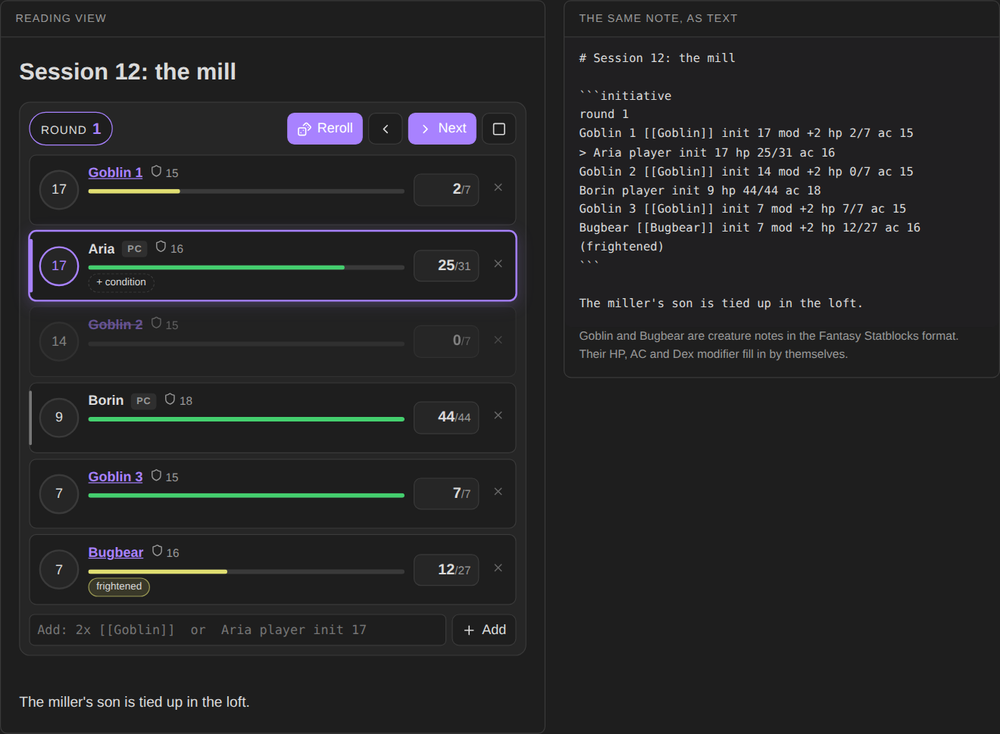

# Quick Initiative

A light initiative tracker for Obsidian. The whole fight lives as plain text in your note, so it syncs, survives restarts, and still reads fine if you ever uninstall the plugin.



**Try it in your browser** before installing: https://bulkhead.bananafest-destiny.com/press/quick-initiative/ runs the real plugin code over a sample note and shows the note's text changing as you play.

## Start a fight

Write an `initiative` block, one combatant per line:

````
```initiative
Aria player init 17 hp 31 ac 16
Borin player hp 44 ac 18
3x [[Goblin]]
[[Bugbear]]
```
````

Switch to reading view (or live preview) and the block becomes a tracker. Press **Roll initiative**: creatures roll d20 plus their modifier, players keep the number you gave them, and everyone is sorted. **Next** moves the turn and counts rounds.

The command **Insert initiative block** drops a starter block at the cursor.

## Creature notes

Link a creature note and its numbers fill in by themselves. Quick Initiative reads the frontmatter that Fantasy Statblocks uses:

```yaml
---
statblock: true
hp: 7
ac: 15
hit_dice: 2d6
stats: [8, 14, 10, 10, 8, 8]
---
```

HP comes from `hp`, AC from `ac`, and the initiative modifier from Dex (the second of `stats`), or from an `initiative` or `modifier` field if the note has one. Turn on **Roll creature HP** in settings to roll `hit_dice` instead of taking the average. Creatures kept only in Fantasy Statblocks' own bestiary (not as notes) are not read; give them `hp` and `ac` on the line.

## At the table

| Do | How |
| --- | --- |
| Damage or heal | click the HP box, type an amount, press Damage (or Enter) or Heal |
| Set a player's roll | click the initiative circle |
| Add a condition | hover a row and click **+ condition**; click a condition to remove it |
| Add mid-fight | type in the add box: `2x [[Goblin]]`, `Cleric player init 14 hp 22`, `Wolf hp 11 ac 13 init +2` |
| Open a creature's note | click its name |
| Remove someone | the × on the row |

Creatures at 0 HP are greyed out and skipped on their turn. Players are never skipped.

## The text format

Every change is written back into the block, so you can also just edit the text:

```
round 2
> Goblin 2 [[Goblin]] init 14 mod +2 hp 5/7 ac 15 (prone, poisoned)
Aria player init 12 hp 31/31 ac 16
```

| Write | Meaning |
| --- | --- |
| `round 2` | the round; leave it out before the fight starts |
| `>` at the start | whose turn it is |
| `[[Note]]` | the creature note to read numbers from |
| `3x` or `x3` | that many copies, numbered |
| `player` | a player character: keeps their initiative, never skipped |
| `init 14` / `init +2` | the initiative roll / the modifier |
| `mod +2` | the modifier |
| `hp 5/7` or `hp 7` | current and max HP |
| `ac 15` | armor class |
| `(prone, poisoned)` | conditions |

Opening a note never changes it. Numbers read from creature notes are written into the block the first time you change something.

## For other plugins

Each change fires a workspace event with the round, whose turn it is, and everyone's initiative and HP:

```ts
this.registerEvent(this.app.workspace.on('quick-initiative:change', (e) => console.log(e.round, e.current)));
```

## Privacy

Quick Initiative does not use the network, has no accounts, collects nothing and sends nothing. It only edits the `initiative` block it is drawing.

## Install

From Obsidian: Settings → Community plugins → Browse → search "Quick Initiative".

By hand: copy `main.js`, `manifest.json` and `styles.css` from the latest release into `<your vault>/.obsidian/plugins/quick-initiative/`, then enable it under Community plugins.

## Also from this maker

- [Dice Tray](https://github.com/walkertbrown/dice-tray): rolls dice, random tables and note sections inline, and reads Dice Roller's `dice:` syntax.
- [Session Log](https://github.com/walkertbrown/session-log): a quick log for game night. With it installed, fights log themselves: when they start, who goes down, how many rounds.
- [Encounter Builder](https://github.com/walkertbrown/encounter-builder): plan fights against the 5E XP budget, then start them in Quick Initiative.
- [Progress Clocks](https://github.com/walkertbrown/progress-clocks): segmented clocks for danger, plans and factions, ticked with a click and kept as text in the note.

## Source

https://github.com/walkertbrown/quick-initiative

## Build

```
npm install
npm test
npm run build
```

MIT licensed.
